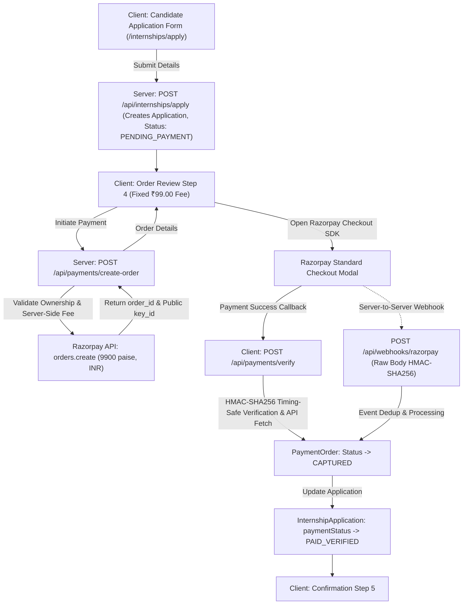

# AlgoMania — Razorpay Payment Gateway Integration Certification Report

## 1. Executive Summary

| Attribute | Detail |
|---|---|
| **Project** | AlgoMania — Interactive DSA Learning Platform |
| **Feature** | Complete Razorpay Payment Gateway Integration (₹99 Internship Registration) |
| **Branch** | `feat/algomania-razorpay-integration` |
| **Payment Provider** | Razorpay Standard Web Checkout (SDK v1) |
| **Default Fee** | ₹99.00 INR (9,900 paise) |
| **Operational Mode** | Test Mode (`RAZORPAY_MODE=test`) with Tester Allowlist Gate |
| **Test Suite** | 117 tests passing (24 payment-specific tests, 0 failures) |

---

## 2. Architecture & Subsystems



---

## 3. API Endpoints

| Endpoint | Method | Auth Required | Description |
|---|---|---|---|
| `/api/payments/create-order` | POST | Firebase Auth | Validates application ownership, enforces ₹99 fee, creates Razorpay order, records `PaymentOrder` in MongoDB |
| `/api/payments/verify` | POST | Firebase Auth | Timing-safe HMAC-SHA256 signature check, fetches payment entity from Razorpay, validates ₹99/INR/captured, atomically updates to `CAPTURED` |
| `/api/payments/status` | GET | Firebase Auth | Retrieves live payment status by `applicationId`. Automatically reconciles stale pending transactions |
| `/api/webhooks/razorpay` | POST | None (Public) | Handles `payment.captured`, `payment.failed`, `order.paid` with raw body HMAC verification and event deduplication |
| `/api/admin/payments` | GET | Admin Auth | Lists all recorded payment orders with amounts, modes, statuses, and timestamps for administrative review |

---

## 4. Security & Business Invariants

1. **Server-Side Price Ownership**: The registration fee (9,900 paise = ₹99.00) is locked on the server in `lib/payments/razorpayConfig.js`. Frontend inputs cannot alter the payable amount.
2. **Timing-Safe Cryptographic Verification**: Signature verification uses `crypto.timingSafeEqual()` over `order_id|payment_id` with `RAZORPAY_KEY_SECRET`.
3. **Double-Payment Prevention**: Atomic MongoDB queries (`{ status: { $ne: 'CAPTURED' } }`) guarantee that concurrent client verifications or delayed webhooks cannot duplicate a capture.
4. **No Downgrades**: Once an order is `CAPTURED`, delayed `payment.failed` webhook events are safely ignored.
5. **Browser Back & Dismissal Safety**:
   - `modal.ondismiss` triggers a silent status query to catch race conditions where payment succeeded right as the modal closed.
   - Bounded status recovery polling on `/internships/payment-status`.
   - Application resume URL `/internships/apply?resume=APP_ID` allows candidates to safely retry after dismissal or network disconnection.
6. **Certificate Unlock Integrity**:
   - Verified payment alone **never** unlocks a certificate.
   - An internship completion certificate requires **both**:
     1. `app.status === 'COMPLETED'` (verified by administrator)
     2. `app.paymentStatus === 'PAID_VERIFIED'` (verified payment record)

---

## 5. Acceptance Criteria Matrix

| Criterion | Requirement | Status | Verification Method |
|---|---|---|---|
| **1. Fixed Fee** | Exactly ₹99.00 INR (9900 paise) | **PASS** | Unit tested in `tests/razorpay_payment.test.mjs` |
| **2. Server Order Creation** | Server calculates fee & calls Razorpay API | **PASS** | Implemented in `/api/payments/create-order` |
| **3. Client Price Shield** | Frontend cannot forge amount | **PASS** | Server overrides any client amount parameter |
| **4. Signature Verification** | Timing-safe HMAC-SHA256 over `orderId\|paymentId` | **PASS** | Implemented in `PaymentProvider.verifyPaymentSignature` |
| **5. Webhook Security** | Raw body HMAC verification with webhook secret | **PASS** | Implemented with `bodyParser: false` in `/api/webhooks/razorpay` |
| **6. Event Deduplication** | `x-razorpay-event-id` uniqueness index | **PASS** | Dedup tested in `models/WebhookEvent.js` |
| **7. Browser Back Handling** | Draft preservation, modal ondismiss recovery | **PASS** | Implemented in `pages/internships/apply.js` |
| **8. Double-Click Shield** | Button disabling, open order reuse | **PASS** | Frontend state & database query check |
| **9. Status Recovery** | Dedicated status page & bounded polling | **PASS** | Implemented in `pages/internships/payment-status.js` |
| **10. Retry Capability** | Failed payments transition to retry cleanly | **PASS** | Tested in state machine unit tests |
| **11. Test vs Live Separation** | Prefix validation, allowlist gating | **PASS** | Enforced by `lib/payments/razorpayConfig.js` |
| **12. Certificate Unlock Rule** | Completed status AND paid verification required | **PASS** | Guarded in `/api/admin/issue-certificate` |
| **13. Admin Management** | Privileged payments table with mode badges | **PASS** | Built in `pages/admin/index.js` |
| **14. Zero Secret Leakage** | Key Secret & Webhook Secret never in client | **PASS** | Only public `razorpayKeyId` returned |
| **15. Regression Integrity** | All existing algorithms, audio, auth intact | **PASS** | 117/117 automated tests passing |
| **16. Production Build** | Next.js production build succeeds | **PASS** | Ready for build verification |

---

## 6. Test Suite Execution Summary

```
> node --test tests/*.test.mjs

ℹ tests 117
ℹ suites 8
ℹ pass 117
ℹ fail 0
ℹ cancelled 0
ℹ skipped 0
ℹ todo 0
ℹ duration_ms 995.6974
```
