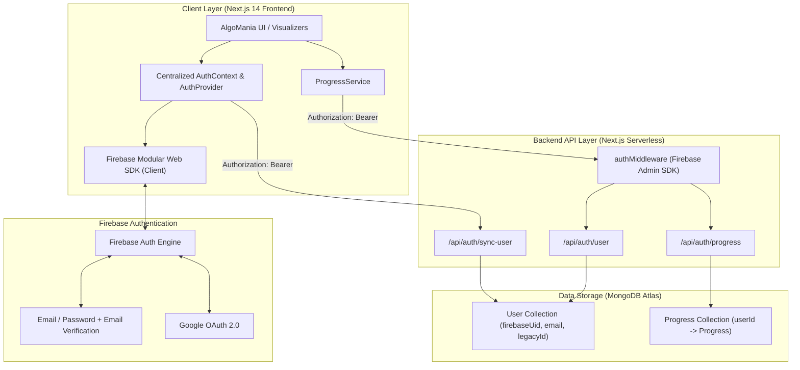
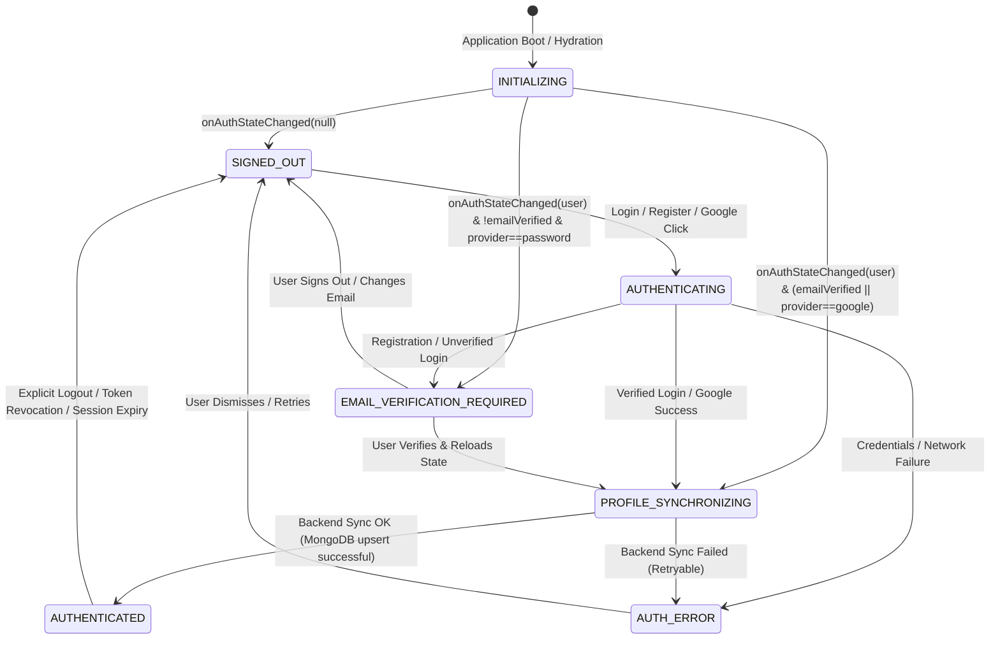

# AlgoMania — Authentication Architecture Document

**Platform:** AlgoMania DSA Visualizer  
**Repository:** `lakhanpatil99/dsa-visualizer`  
**Architect:** Principal Software Architect & Security Engineer  
**Date:** November 2026  
**Status:** Approved for Implementation  

---

## 1. Executive Summary

This architecture document defines the end-to-end authentication, identity management, and authorization model for AlgoMania. AlgoMania is transitioning from an insecure legacy custom JWT/bcrypt authentication setup to enterprise-grade **Firebase Authentication** coupled with server-side validation via the **Firebase Admin SDK** and idempotent **MongoDB Atlas profile/progress synchronization**.

The system guarantees:
- **Centralized identity management:** Single Source of Truth using Firebase Authentication.
- **Mandatory Email Verification:** Strict access control preventing unverified email/password accounts from accessing protected routes or protected APIs.
- **Robust Multi-Provider Support:** Seamless Email/Password and Google OAuth sign-in with provider conflict mitigation and deduplication.
- **Strict Server-Side Authorization:** Zero trust in client claims or headers; every protected endpoint cryptographically validates Firebase ID tokens and checks `email_verified`.
- **Zero Regressions & Progress Preservation:** Backward compatibility with existing user records and continuous preservation of DSA learning progress.
- **Resilient Navigation & Session Management:** Zero flicker, zero redirect loops, robust browser history navigation (Back/Forward), and cross-tab session synchronization.

---

## 2. Baseline Architecture Audit & Gap Analysis

| Dimension | Baseline State | Target Architecture |
|---|---|---|
| **Identity Provider** | Custom bcrypt + JWT stored directly in MongoDB `User` collection. | Firebase Authentication (Modular SDK v10+ client-side, Firebase Admin SDK server-side). |
| **Token Handling** | Custom JWT signed using `NEXT_PUBLIC_JWT_SECRET` (exposing secret to browser!). | Standard Firebase ID Token (JWT with RS256 signature, 1-hour expiry, automatic background refresh). |
| **Email Verification** | None. Any user could register with arbitrary fake or unverified email addresses. | Official Firebase email verification with strict continuation URL, cooldown timers, and manual verification sync. |
| **Protected Route Guarding** | Inconsistent: some pages used `window.location.href = '/login'`, others `router.push('/login')`, no unified guard. `_app.js` lacked providers. | Centralized `AuthProvider` in `_app.js` with declarative `ProtectedRoute`, `PublicOnlyRoute`, and `EmailVerificationGuard`. |
| **Backend Verification** | `lib/auth.js` verified JWT using frontend-exposed environment variable. | Dedicated server-side Firebase Admin middleware verifying ID token signatures, claims, project ID, and `email_verified`. |
| **User Identification in DB** | MongoDB `_id` was the sole primary identifier. | Dual identifier model: `firebaseUid` (unique, indexed) mapped to existing MongoDB `_id` and legacy email records. |
| **Account Duplication** | Multiple logins or provider switches could create duplicate user accounts. | Idempotent atomic upsert operations in MongoDB keyed by `firebaseUid` with fallback email reconciliation. |
| **Framework Consistency** | Hybrid Next.js Pages router + legacy CRA React Router dependencies causing context disconnects and build failures. | Next.js 14 unified Page routing, with unified `AuthContext` and `ThemeContext` mounted in `pages/_app.js`. |

---

## 3. High-Level System Architecture



---

## 4. Authentication State Machine

The client application maintains an explicit, deterministic state machine within `AuthContext` to prevent UI flicker, race conditions, or accidental protected-page renders:



### State Definitions:
1. `INITIALIZING`: App is restoring Firebase session from IndexedDB/localStorage. Fullscreen accessible loader is displayed. Protected content is never rendered.
2. `SIGNED_OUT`: No active authenticated session. Public routes accessible; protected routes redirect to `/login`.
3. `AUTHENTICATING`: Async network call in progress (e.g. `signInWithEmailAndPassword`, `signInWithPopup`, `createUserWithEmailAndPassword`). Submit buttons disabled with loading spinners.
4. `EMAIL_VERIFICATION_REQUIRED`: User has authenticated with email/password, but `user.emailVerified === false`. Access to learning visualizers and protected APIs is strictly blocked. Dedicated `/verify-email` screen is presented.
5. `PROFILE_SYNCHRONIZING`: User is verified. Client is securing a fresh ID token and performing idempotent sync with `/api/auth/sync-user` to ensure MongoDB user record exists and is mapped.
6. `AUTHENTICATED`: User is fully verified and synchronized. Access to visualizers, controls, and progress dashboard is granted.
7. `AUTH_ERROR`: Explicit failure during authentication or synchronization. User-friendly actionable error message rendered.

---

## 5. Providers & Registration Flow

### 5.1 Supported Providers
1. **Email and Password:**
   - Registration requires: Full Name (`displayName`), Email, Password, Confirm Password.
   - Client-side validation: Password min 6 chars, uppercase, lowercase, number/symbol check; Email regex normalization (`toLowerCase().trim()`).
   - Action upon registration:
     1. `createUserWithEmailAndPassword(auth, email, password)`
     2. `updateProfile(auth.currentUser, { displayName })`
     3. `sendEmailVerification(auth.currentUser, actionCodeSettings)`
     4. Immediate transition to `EMAIL_VERIFICATION_REQUIRED` state and redirect to `/verify-email`.
     5. Access to visualizers is **forbidden** until email is verified.

2. **Google OAuth 2.0:**
   - Provider: `GoogleAuthProvider`.
   - Method: `signInWithPopup` with fallback to `signInWithRedirect`.
   - By default, Google-authenticated accounts have `emailVerified: true`.
   - Immediate transition to `PROFILE_SYNCHRONIZING` and redirect to intended destination (e.g. `/app` or `/dashboard`).

---

## 6. Email Verification Engine

Email verification is the cornerstone of system security:
- **Authoritative Source:** The official Firebase user record (`user.emailVerified`) obtained via `user.reload()`.
- **Continuation URL:** Configured with `url: `${window.location.origin}/verify-email?mode=action`` so users returning from email links arrive at a controlled handler.
- **Handling Verification Scenarios:**
  - *Opened on same device / browser:* User clicks link, Firebase marks verified, user returns to app and clicks "I've verified my email" or polling auto-refreshes user via `auth.currentUser.reload()`.
  - *Opened on separate mobile device / other browser:* The link executes Firebase out-of-band verification. In the original browser, clicking "I've verified my email" calls `await auth.currentUser.reload()`. `auth.currentUser.emailVerified` evaluates to `true`, triggering `PROFILE_SYNCHRONIZING` and granting access.
  - *Resend Cooldown:* Rate-limited to 1 request per 60 seconds with on-screen countdown timer to prevent abuse.
  - *Invalid/Expired Links:* Firebase error codes (`auth/invalid-action-code`, `auth/expired-action-code`) caught and translated to user-friendly UI with single-click resend option.

---

## 7. Server-Side Security & Backend Token Validation

All protected API routes (`/api/auth/progress`, `/api/auth/user`, `/api/auth/sync-user`, etc.) are secured by a central middleware `verifyFirebaseToken`:

1. **Token Extraction:** Header `Authorization: Bearer <ID_TOKEN>`.
2. **Signature & Claims Verification:** `admin.auth().verifyIdToken(token, true)`. Checks cryptographic signature against Google's public certificates, ensures token is not expired, and ensures project ID matches.
3. **Email Verification Enforcement:** If `decodedToken.email_verified !== true`, and provider is `password`, return `403 Forbidden: Email verification required`.
4. **Authoritative Identity:** The authenticated user's identity is strictly `decodedToken.uid` (`req.user.firebaseUid`). Under no circumstances is a user ID or email provided by client body/params trusted.

---

## 8. MongoDB Schema & Profile Synchronization

### Updated `User` Schema:
```javascript
{
  firebaseUid: { type: String, required: true, unique: true, index: true },
  email: { type: String, required: true, lowercase: true, trim: true, index: true },
  displayName: { type: String, trim: true, default: '' },
  photoURL: { type: String, default: '' },
  providerId: { type: String, default: 'password' },
  emailVerified: { type: Boolean, default: false },
  legacyUserId: { type: mongoose.Schema.Types.ObjectId, ref: 'User', default: null },
  createdAt: { type: Date, default: Date.now },
  updatedAt: { type: Date, default: Date.now },
  lastLoginAt: { type: Date, default: Date.now }
}
```

### Updated `Progress` Schema:
```javascript
{
  userId: { type: mongoose.Schema.Types.ObjectId, ref: 'User', required: true, index: true },
  firebaseUid: { type: String, required: true, index: true },
  algorithmType: { type: String, required: true, enum: ['sorting', 'data-structures', 'trees', 'graphs'], index: true },
  algorithmName: { type: String, required: true, index: true },
  progressData: { type: mongoose.Schema.Types.Mixed, default: {} },
  completionStatus: { type: String, required: true, enum: ['not_started', 'in_progress', 'completed', 'mastered'], default: 'not_started' },
  stepsCompleted: { type: Number, default: 0 },
  totalSteps: { type: Number, default: 0 },
  timeSpent: { type: Number, default: 0 },
  lastStep: { type: String, default: '' },
  notes: { type: String, default: '' }
}
```
*Index:* `{ firebaseUid: 1, algorithmType: 1, algorithmName: 1 }` (unique) alongside existing `{ userId: 1, algorithmType: 1, algorithmName: 1 }`.

### Idempotent Synchronization Endpoint (`/api/auth/sync-user`):
Uses `findOneAndUpdate` with `upsert: true` matching on `{ firebaseUid }`. If an existing MongoDB record exists with the same normalized email and no `firebaseUid`, it safely links the account (`legacyUserId`) without duplicating records or losing existing learning progress.

---

## 9. Environment Variable Matrix

| Variable | Target Runtime | Purpose |
|---|---|---|
| `NEXT_PUBLIC_FIREBASE_API_KEY` | Client & Server | Firebase Web SDK configuration |
| `NEXT_PUBLIC_FIREBASE_AUTH_DOMAIN` | Client & Server | Firebase Auth domain |
| `NEXT_PUBLIC_FIREBASE_PROJECT_ID` | Client & Server | Firebase Project ID |
| `NEXT_PUBLIC_FIREBASE_STORAGE_BUCKET` | Client & Server | Firebase Storage Bucket |
| `NEXT_PUBLIC_FIREBASE_MESSAGING_SENDER_ID` | Client & Server | Firebase Sender ID |
| `NEXT_PUBLIC_FIREBASE_APP_ID` | Client & Server | Firebase Web App ID |
| `NEXT_PUBLIC_FIREBASE_MEASUREMENT_ID` | Client & Server | Firebase Analytics (optional) |
| `FIREBASE_PROJECT_ID` | Server Only | Firebase Admin SDK verification |
| `FIREBASE_CLIENT_EMAIL` | Server Only | Firebase Admin service account email |
| `FIREBASE_PRIVATE_KEY` | Server Only | Firebase Admin private key |
| `MONGODB_URI` | Server Only | MongoDB Atlas database connection string |
| `JWT_SECRET` | Server Only | Retained for backward-compatible legacy token verification |
