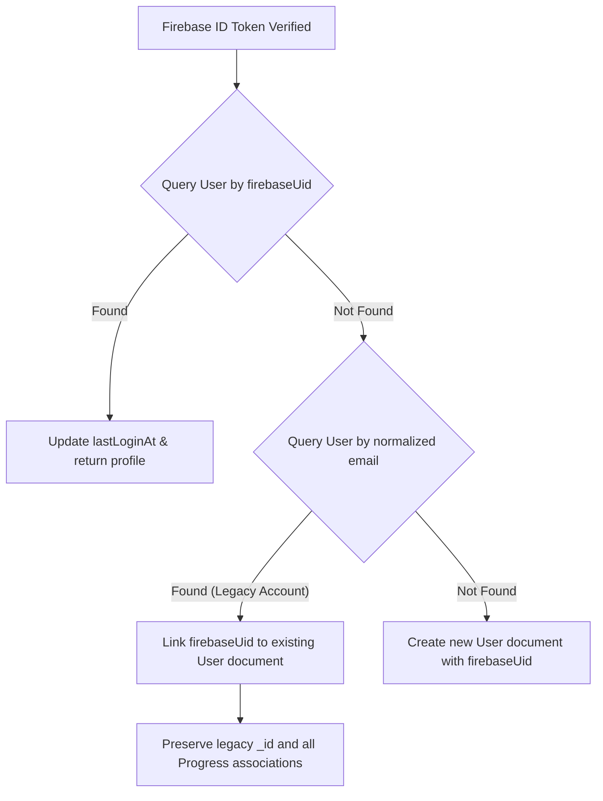

# AlgoMania — Legacy Account & Database Migration Plan

**Platform:** AlgoMania DSA Visualizer  
**Repository:** `lakhanpatil99/dsa-visualizer`  
**Architect:** Principal Software Architect & Reliability Engineer  
**Date:** November 2026  
**Status:** Approved for Implementation  

---

## 1. Context & Baseline Audit

The original AlgoMania application utilized a local authentication system backed by MongoDB with the following components:
1. **User Collection:**
   - `username`: String (3-30 chars)
   - `email`: String (lowercase, unique)
   - `password`: String (bcrypt hash with 12 salt rounds)
   - `createdAt`: Date
2. **Progress Collection:**
   - `userId`: `mongoose.Schema.Types.ObjectId` referencing `User._id`
   - `algorithmType`: 'sorting' | 'data-structures' | 'trees' | 'graphs'
   - `algorithmName`: String
   - Compound unique index: `{ userId: 1, algorithmType: 1, algorithmName: 1 }`
   - Progress fields: `progressData`, `completionStatus`, `stepsCompleted`, `totalSteps`, `timeSpent`, `lastStep`, `notes`
3. **Session Mechanism:**
   - JWT issued upon `/api/auth/login` and `/api/auth/register` signed with `NEXT_PUBLIC_JWT_SECRET`.
   - Stored in `localStorage` under keys `authToken` and `user`.

---

## 2. Migration Principles (Non-Negotiable)

1. **Zero Data Destruction:** No existing user account, password hash, or progress record in MongoDB will be dropped or modified destructively.
2. **Reversible Schema Evolution:** All schema updates are additive. Older versions of the API or database queries continue to function without crashing.
3. **Password Security:** Plaintext passwords cannot and will not be recovered from bcrypt hashes.
4. **No Ghost / Duplicate Accounts:** Multiple login attempts or provider linkings must not create duplicate MongoDB user documents for the same person.
5. **Progress Preservation:** When a legacy user completes migration to Firebase, their existing `Progress` documents linked to their legacy `ObjectId` are preserved and accessible.

---

## 3. Step-by-Step Migration Strategy

### Step 3.1: Additive Schema Enhancements
The `User` schema is enhanced to accommodate both legacy accounts and new Firebase identities:
```javascript
// models/User.js
const UserSchema = new mongoose.Schema({
  username: {
    type: String,
    trim: true,
    minlength: 3,
    maxlength: 50
  },
  email: {
    type: String,
    required: true,
    unique: true,
    trim: true,
    lowercase: true,
    index: true
  },
  password: {
    type: String,
    required: false // Optional for Firebase OAuth users
  },
  firebaseUid: {
    type: String,
    unique: true,
    sparse: true, // Allows legacy records without firebaseUid to coexist
    index: true
  },
  displayName: {
    type: String,
    trim: true
  },
  photoURL: {
    type: String
  },
  providerId: {
    type: String,
    default: 'password'
  },
  emailVerified: {
    type: Boolean,
    default: false
  },
  createdAt: {
    type: Date,
    default: Date.now
  },
  updatedAt: {
    type: Date,
    default: Date.now
  },
  lastLoginAt: {
    type: Date,
    default: Date.now
  }
});
```

*Key Technical Detail:* `sparse: true` on `firebaseUid` is essential. It allows legacy users who have not yet logged in through Firebase to remain in MongoDB without violating the unique constraint on `firebaseUid`.

### Step 3.2: Account Reconciliation & On-Demand Migration
When a user signs into Firebase (via Email/Password or Google):
1. The client receives the Firebase ID token and calls `POST /api/auth/sync-user` with `Authorization: Bearer <ID_TOKEN>`.
2. The server decodes the token with Firebase Admin SDK, obtaining authoritative `uid`, `email`, and `email_verified`.
3. The server executes an idempotent upsert workflow:
   - **Case A: Existing Firebase User**
     Query by `{ firebaseUid: uid }`. If found, update `lastLoginAt`, `emailVerified`, and `updatedAt`. Return the MongoDB user profile.
   - **Case B: Legacy User First-Time Firebase Login**
     Query by `{ email: normalizedEmail }` where `firebaseUid` is not set or matches.
     If a legacy document is found:
     - Atomically attach `firebaseUid = uid`.
     - Update `emailVerified = decodedToken.email_verified`.
     - Update `lastLoginAt = new Date()`.
     - Any existing progress records linked to this user's `_id` remain intact!
   - **Case C: Brand New User**
     No record matches `firebaseUid` or `email`.
     Create a new User document with `firebaseUid = uid`, `email = normalizedEmail`, `displayName`, `emailVerified`.



### Step 3.3: Handling Legacy Hashed Password Accounts
For users who previously had local accounts with passwords hashed in bcrypt:
1. **Password Reset / Account Claiming:**
   - If a legacy user registers or requests password reset in Firebase with their existing email, Firebase sends a password reset email.
   - Once the user sets their password in Firebase and verifies their email, Firebase issues a valid ID token.
   - On first login, Step 3.2 (Case B) detects their email, links `firebaseUid` to their existing MongoDB document, and retains their complete progress history!
2. **Google OAuth Automatic Linking:**
   - If a legacy user signs in with Google using their matching verified email, Firebase verifies their identity.
   - Step 3.2 (Case B) automatically associates their Google `firebaseUid` with their existing MongoDB progress.

### Step 3.4: Progress Model Dual-Query Support
To ensure progress is never lost regardless of whether a record is referenced by MongoDB `_id` or `firebaseUid`:
In `/api/auth/progress`:
1. Find user by `firebaseUid`. Let user doc be `dbUser`.
2. Find progress matching:
   `{ $or: [ { firebaseUid: req.user.firebaseUid }, { userId: dbUser._id } ] }`
3. When saving new progress, always record both `userId: dbUser._id` and `firebaseUid: req.user.firebaseUid`.
This guarantees 100% backward compatibility with legacy progress while migrating forward to `firebaseUid`.

---

## 4. Rollback & Contingency Strategy

If an unexpected production incident occurs during deployment:

1. **Database Rollback:**
   - Because all changes to `User` and `Progress` are strictly additive (`sparse: true` index and new optional fields), no migration script needs to be reverted.
   - Legacy records retain their original `_id`, `email`, `password`, and `createdAt` fields intact.
2. **Application Rollback:**
   - The git repository retains the commit baseline `Initial commit of downloaded repository baseline`.
   - Vercel deployments allow 1-click rollback to any previous deployment hash in the Vercel dashboard.
3. **Feature Flag / Graceful Degradation:**
   - If Firebase Admin credentials are misconfigured or missing in an environment, the API returns descriptive HTTP 503 Service Unavailable errors without corrupting the database.
